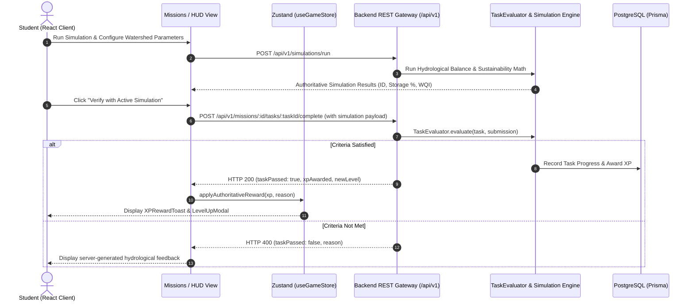

# JalRakshak — Gamification & Progression Frontend Specification

## 1. Architectural Philosophy: Server-Authoritative Progression

In JalRakshak, all gamification logic, mission task evaluation, XP ledger credits, level calculation, and achievement unlocking are **strictly server-authoritative**. The frontend is an interactive visualization and gameplay canvas; it **never** calculates or awards XP client-side, never invents progression state, and never determines task success independently.

---

## 2. Core Frontend Components

### 2.1 Missions Hub (`MissionsPage.tsx`)
- **Category Filtering**: 8 hydrological categories:
  - `GROUNDWATER_CONSERVATION`
  - `RAINWATER_HARVESTING`
  - `SUSTAINABLE_AGRICULTURE`
  - `IRRIGATION_EFFICIENCY`
  - `WATER_QUALITY`
  - `POLLUTION_PREVENTION`
  - `COMMUNITY_AWARENESS`
  - `DROUGHT_MANAGEMENT`
- **Difficulty Levels**: `BEGINNER`, `INTERMEDIATE`, `ADVANCED`.
- **Search & Sort**: Full-text searching across mission titles and hydro objectives; sorting by Level, XP Reward, or Duration.
- **Directives State**: Distinguishes Available, In Progress, Completed, and Locked directives.

### 2.2 Mission Detail & Task Launcher (`MissionDetail.tsx` & `MissionTaskList.tsx`)
- Detailed mission briefing, pedagogical learning objectives, operational instructions, and task progress.
- Task execution workflow:
  - Simulation-dependent tasks (`COMPLETE_SIMULATION`, `ACHIEVE_STORAGE_THRESHOLD`, `USE_DRIP_IRRIGATION`, `BUILD_CONSERVATION_STRUCTURE`, etc.) inspect verified simulation runs and submit server-side evaluation requests.
  - Hydrology Quiz tasks (`COMPLETE_QUIZ`) render interactive questions and verify answers against server-side answer keys.

### 2.3 Quests & Time-Bound Challenges (`ChallengesPage.tsx` & `ChallengeTimer.tsx`)
- Real-time countdown clock computed down to seconds.
- Categorization into Daily and Weekly quests with duplicate-join prevention (`409 Conflict`).
- Expired state when `endDate < now`.

### 2.4 Authoritative Progression HUD (`TopHUD.tsx`, `LevelBadge.tsx`, `XPProgressBar.tsx`)
- Canonical 6-Tier Level Progression:
  - **Level 1 — Water Explorer**: 0 XP
  - **Level 2 — Water Guardian**: 500 XP
  - **Level 3 — Aquifer Protector**: 1,200 XP
  - **Level 4 — Conservation Champion**: 2,500 XP
  - **Level 5 — Groundwater Hero**: 5,000 XP
  - **Level 6 — JalRakshak Master**: 10,000 XP
- Reactive level-up celebrations via `LevelUpModal.tsx` and toast notifications via `XPRewardToast.tsx`.

### 2.5 Achievements & Honor Badges (`AchievementsPage.tsx` & `BadgeCollection.tsx`)
- Catalogs all 8 Phase 8 achievements: `FIRST_MISSION`, `WATER_SAVER`, `RAIN_HARVESTER`, `DRIP_CHAMPION`, `AQUIFER_GUARDIAN`, `CLEAN_WATER_HERO`, `DROUGHT_SURVIVOR`, `CONSERVATION_MASTER`.
- Categorized tabs (All, Unlocked, Locked) with unlock condition metadata.

### 2.6 Privacy-Preserving Leaderboard (`LeaderboardPage.tsx` & `LeaderboardTable.tsx`)
- 4 Ranking Views: Total XP, Weekly XP, Missions Completed, Honor Badges.
- Preserves privacy: zero student emails, auth credentials, or sensitive personal data exposed.
- Current student row highlighted.

### 2.7 Teacher Supervisory Assignment Desk (`MissionAssignmentPanel.tsx`)
- Teacher-only interface to assign missions to supervised students, set deadlines, and inspect detailed student progression reports.
