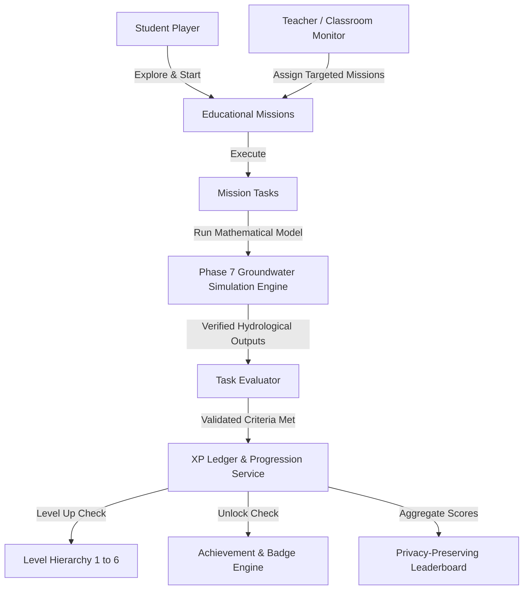

# JalRakshak Gamification, Quests, Missions & Educational Progression System

## 1. Overview & Gamification Philosophy

The **JalRakshak Gamification Engine** transforms abstract hydrogeological concepts into an immersive, outcome-driven learning journey. By connecting real simulation outputs from the scientific groundwater engine (Phase 7) to quest objectives, students witness the direct environmental consequences of their conservation decisions while earning XP, unlocking badges, and progressing through six mastery tiers.

---

## 2. Mission Categories & Curriculum Alignment

Missions are grouped across 8 critical water management domains:

| Category | Domain Scope | Learning Outcome |
| :--- | :--- | :--- |
| **`GROUNDWATER_CONSERVATION`** | Aquifer water budgeting & storage balance | Understand recharge vs extraction mass balance |
| **`RAINWATER_HARVESTING`** | Surface runoff arrest & percolation | Deploy check dams, percolation tanks, and contour bunds |
| **`SUSTAINABLE_AGRICULTURE`** | Crop diversification & water duties | Replace water-thirsty cash crops with millets and pulses |
| **`IRRIGATION_EFFICIENCY`** | Precision micro-irrigation systems | Transition from flood to drip/sprinkler saving up to 48% water |
| **`WATER_QUALITY`** | Non-point source pollution mitigation | Understand agrochemical leaching and protect drinking water |
| **`POLLUTION_PREVENTION`** | Sewage management & soak pits | Implement managed village soak pits and biological reed beds |
| **`COMMUNITY_AWARENESS`** | Village groundwater governance | Foster community consensus on water budgeting |
| **`DROUGHT_MANAGEMENT`** | Crisis management during monsoon deficit | Formulate emergency rationing protocols during drought years |

---

## 3. Mission Task Types & Verification Engine

Mission completion requires completing structured sub-tasks. Task verification is executed strictly on the server by inspecting actual simulation outputs or verified quiz submissions:

| Task Type | Verification Logic | Simulation Data Source |
| :--- | :--- | :--- |
| **`COMPLETE_SIMULATION`** | Verifies execution of a valid simulation run | `simulationId`, `scenarioId`, `sustainabilityScore` |
| **`ACHIEVE_STORAGE_THRESHOLD`** | Verifies ending storage percentage | `waterBalance.storagePercentage >= minStoragePercentage` |
| **`IMPROVE_SUSTAINABILITY_SCORE`** | Verifies composite sustainability rating | `sustainability.overallScore >= minScore` |
| **`USE_DRIP_IRRIGATION`** | Verifies micro-irrigation method & water savings | `sectors.irrigationMethod === 'DRIP'`, `waterSavingsM3 > 0` |
| **`BUILD_CONSERVATION_STRUCTURE`** | Verifies artificial recharge from interventions | `interventions.artificialRechargeM3 >= minRechargeM3` |
| **`COMPLETE_WATER_QUALITY_CHALLENGE`**| Verifies simulated Water Quality Index | `waterQuality.finalWQI >= minWQI` |
| **`REDUCE_GROUNDWATER_EXTRACTION`** | Verifies total extraction stays below cap | `waterBalance.extractionM3 <= maxExtractionM3` |
| **`COMPLETE_QUIZ`** | Evaluates answers against server answer key | `submittedAnswers` vs `answerKey` (pass $\ge 70\%$) |

> [!CAUTION]
> **Zero-Trust Client Verification**:
> The client cannot submit arbitrary completion flags or XP values. Every task completion is recomputed from the authoritative simulation state or verified server answer key.

---

## 4. Achievement & Badge Catalog

Achievements recognize exemplary conservation milestones and award one-time XP bonuses:

| Code | Badge Name | Description | Icon | XP Reward | Unlock Criteria |
| :--- | :--- | :--- | :--- | :---: | :--- |
| `FIRST_MISSION` | **Water Pioneer** | Complete your first conservation mission | `award` | $100\text{ XP}$ | Completed Missions $\ge 1$ |
| `WATER_SAVER` | **Efficiency Champion** | Save $20,000\text{ m}^3$ or more through conservation | `droplet` | $150\text{ XP}$ | Water Savings $\ge 20,000\text{ m}^3$ |
| `RAIN_HARVESTER` | **Monsoon Collector** | Capture and recharge runoff with check dams | `cloud-rain` | $150\text{ XP}$ | Artificial Recharge $\ge 10,000\text{ m}^3$ |
| `DRIP_CHAMPION` | **Precision Irrigator** | Complete a challenge using drip micro-irrigation | `gauge` | $200\text{ XP}$ | Irrigation Method = `DRIP` |
| `AQUIFER_GUARDIAN` | **Sustained Water Table** | Maintain storage $\ge 50\%$ while meeting demand | `shield-check` | $250\text{ XP}$ | Storage Percentage $\ge 50\%$ |
| `CLEAN_WATER_HERO` | **Pure Hydrology** | Attain a Water Quality Index above $80$ | `sparkles` | $200\text{ XP}$ | Simulated WQI $\ge 80.0$ |
| `DROUGHT_SURVIVOR` | **Crisis Manager** | Complete drought year without aquifer collapse | `sun` | $300\text{ XP}$ | Drought Scenario storage $> 0\%$ |
| `CONSERVATION_MASTER`| **Master Hydrologist** | Complete 5 or more educational missions | `crown` | $500\text{ XP}$ | Completed Missions $\ge 5$ |

---

## 5. Daily & Weekly Challenges

Challenges present time-bound hydrological objectives to incentivize consistent participation:
- **`DAILY`**: 24-hour duration (e.g. "Daily Drip Master" — $150\text{ XP}$).
- **`WEEKLY`**: 7-day duration (e.g. "Weekly Watershed Builder" — $300\text{ XP}$).
- **Expiry Protection**: Expired challenges reject new participation and completion attempts.
- **Single Reward Rule**: Duplicate claims on the same challenge cycle are strictly blocked.

---

## 6. Teacher Classroom Assignments

Teachers can assign specific educational missions to authorized students:
- Protected by `TeacherStudentAssignment` authorization. Unassigned teachers cannot assign or inspect student records.
- Due dates and pedagogical notes supported.
- Teachers track real-time completion status and student XP growth.

---

## 7. Leaderboard Foundation & Privacy Protection

The leaderboard offers transparent student rankings across four distinct leaderboards:
1. **Total XP Leaderboard** (All-time overall learning score)
2. **Weekly XP Leaderboard** (Past 7-day momentum)
3. **Missions Completed Leaderboard** (Curriculum completion rate)
4. **Achievements Unlocked Leaderboard** (Mastery badges earned)

### Privacy & Governance Guarantees
- **No Sensitive Credential Exposure**: Email addresses, passwords, phone numbers, and private data are stripped. Only `rank`, `studentName`, `score`, and `levelTitle` are returned.
- **Deterministic Tie-Breaking**: When two students tie on score, secondary ordering is deterministically resolved by earlier join date / user ID.
