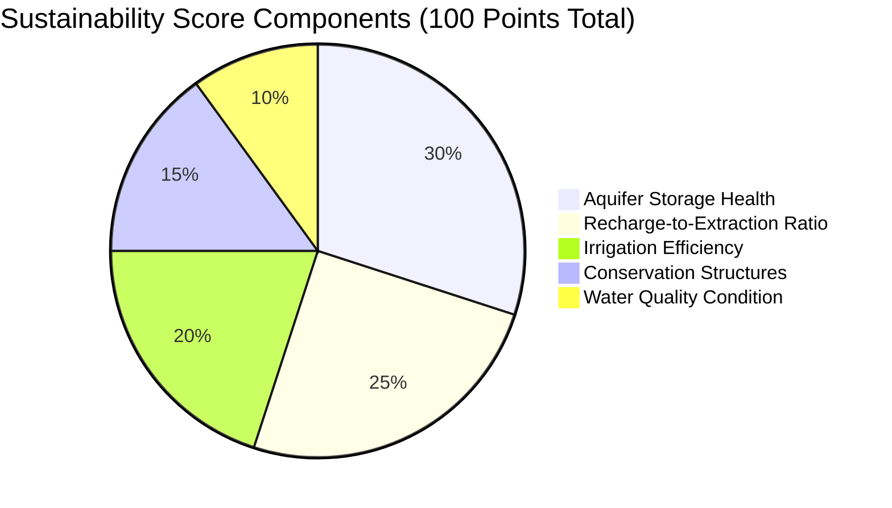

# JalRakshak Groundwater Hydrological Simulation Model & Scientific Equations

## 1. Executive Summary & Pedagogical Scope

The **JalRakshak Groundwater Simulation Engine** models the hydrogeological dynamics of virtual rural Indian village watersheds. It simulates how seasonal precipitation, surface runoff, infiltration, artificial recharge structures, agricultural and domestic extraction, and natural baseflow govern aquifer storage and water table health.

> [!IMPORTANT]
> **Educational Simulation Disclaimer**:
> This engine is designed strictly as a scientific, explainable educational model for student learning, classroom simulation, and interactive game mechanics. It is **not** an operational groundwater forecasting or laboratory chemical safety assessment tool. All generated outputs are explicitly labeled as simulated values.

---

## 2. Fundamental Water Balance Methodology

The core groundwater storage equation is based on the principle of mass conservation within a defined watershed control volume:

$$\Delta S = R + I_{in} - E - D_{nat}$$

For the discrete simulation model:

$$S_{tentative} = S_{initial} + R - E - D_{nat}$$

$$S_{final} = \max\Big(0, \; \min(S_{max}, \; S_{tentative})\Big)$$

Where:
- $S_{initial}$: Groundwater volume in storage at the start of the timestep ($m^3$)
- $S_{final}$: Groundwater volume in storage at the end of the timestep ($m^3$)
- $S_{max}$: Total storage capacity of the local unconfined/semi-confined aquifer ($m^3$)
- $R$: Deep aquifer recharge ($m^3$)
- $E$: Total groundwater extraction / draft ($m^3$)
- $D_{nat}$: Natural baseflow discharge into streams and subsurface boundary outflow ($m^3$)

### Mass Conservation & Boundary Enforcement
1. **Negative Storage Prevention**:
   $$\text{If } S_{tentative} < 0 \implies S_{final} = 0, \quad \text{Unmet Deficit} = |S_{tentative}|$$
   An aquifer cannot contain negative water. When demand exceeds available groundwater, dry borewells occur and unmet deficit is recorded.
2. **Aquifer Saturation & Rejected Recharge**:
   $$\text{If } S_{tentative} > S_{max} \implies S_{final} = S_{max}, \quad \text{Rejected Recharge} = S_{tentative} - S_{max}$$
   Once the pore volume is completely saturated, additional recharge cannot enter the aquifer and is rejected as rejected recharge, daylighting as surface springs or waterlogging.

---

## 3. Hydrological Units Standard

| Metric | Scientific Unit | Simulation Unit | Conversion / Notes |
| :--- | :--- | :--- | :--- |
| **Rainfall Depth** | Millimeters ($mm$) | $mm$ | $1 \text{ mm} = 1 \text{ Liter} / m^2$ |
| **Catchment Area** | Hectares ($ha$) / $m^2$ | $m^2$ | $1 \text{ ha} = 10,000 \text{ m}^2$ |
| **Volumetric Storage / Flux** | Cubic meters ($m^3$) | $m^3$ | $1 \text{ m}^3 = 1,000 \text{ Liters}$ |
| **Domestic Allowance** | Liters per capita per day | $LPCD$ | JJM standard: $55 \text{ LPCD}$ |
| **Water Quality Index** | Dimensionless index | $0.0 - 100.0$ | Composite educational rating |
| **Sustainability Rating** | Dimensionless score | $0 - 100$ | Multi-pillar transparent rating |

---

## 4. Precipitation & Surface Partitioning Model

Precipitation volume ($V_{rain}$) is calculated as:

$$V_{rain} \; (m^3) = \frac{\text{Rainfall Depth } (mm) \times \text{Catchment Area } (m^2)}{1,000}$$

### Partitioning Conservation
To prevent double-counting of runoff and infiltration, the model enforces exact unity:

$$C_{runoff} + C_{infil} + C_{evap} = 1.0$$

$$V_{runoff} = V_{rain} \times C_{runoff}$$
$$V_{infil} = V_{rain} \times C_{infil}$$
$$V_{evap} = V_{rain} \times C_{evap}$$

### Soil Hydrogeology Coefficients

| Soil Category | $C_{runoff}$ | $C_{infil}$ | $C_{evap}$ | Hydrogeological Description |
| :--- | :---: | :---: | :---: | :--- |
| **Sandy Loam** | $0.20$ | $0.55$ | $0.25$ | High porosity, rapid infiltration, minimal surface runoff |
| **Alluvial Soil** | $0.30$ | $0.45$ | $0.25$ | River floodplains; balanced infiltration and retention |
| **Black Cotton (Vertisol)** | $0.45$ | $0.25$ | $0.30$ | Expansive clay; swells when wet; high runoff |
| **Hard Rock (Basalt)** | $0.40$ | $0.35$ | $0.25$ | Deccan Traps peninsular India; fracture-limited percolation |
| **Heavy Clay** | $0.55$ | $0.20$ | $0.25$ | Dense impermeable stratum; prominent runoff |

### Slope Modifiers
- **Flat ($\le 2\%$)**: $C_{infil} \times 1.15, \; C_{runoff} \times 0.85$
- **Moderate ($2 - 8\%$)**: $1.00 \times \text{baseline}$
- **Steep ($> 8\%$)**: $C_{infil} \times 0.75, \; C_{runoff} \times 1.25$

---

## 5. Aquifer Recharge Model

Deep aquifer recharge ($R_{total}$) is the sum of natural percolation and artificial conservation recharge:

$$R_{total} = R_{natural} + R_{artificial}$$

### 1. Natural Recharge ($R_{natural}$)
A fraction of infiltration volume percolates through the unsaturated vadose zone to the water table:

$$R_{natural} = V_{infil} \times \eta_{deep}$$
Where $\eta_{deep} \approx 0.50$ (the remaining $50\%$ satisfies root-zone soil moisture deficiency and vadose storage).

### 2. Artificial Recharge Interventions ($R_{artificial}$)
Community watershed structures arrest surface runoff and induce high-efficiency recharge:

$$V_{captured} = \min\Big(V_{runoff}, \; \sum N_i \times K_i\Big)$$

$$R_{artificial} = V_{captured} \times \bar{\eta}_{eff}$$

Where:
- $N_i$: Count of deployed structures of type $i$
- $K_i$: Runoff capture capacity ($m^3$)
- $\eta_i$: Infiltration efficiency of structure type $i$

| Structure | Capture Capacity ($K_i$) | Efficiency ($\eta_i$) | Purpose |
| :--- | :---: | :---: | :--- |
| **Masonry Check Dam** | $6,000 \text{ m}^3$ | $75\%$ | Slows peak stream velocity and recharges alluvial beds |
| **Percolation Tank** | $25,000 \text{ m}^3$ | $80\%$ | Community impoundment over fractured basalt |
| **Farm Pond / CCT** | $3,000 \text{ m}^3$ | $70\%$ | Field-level moisture retention and decentralized recharge |
| **Rooftop RWH Unit** | $75 \text{ m}^3$ | $85\%$ | Recharges filtered roof runoff into recharge wells |

---

## 6. Groundwater Extraction Model

Total extraction ($E_{total}$) comprises agricultural, domestic, and commercial draft:

$$E_{total} = E_{agri} + E_{domestic} + E_{industrial}$$

### 1. Agricultural Extraction ($E_{agri}$)
Calculated based on crop-specific water duties and irrigation technology efficiency:

$$E_{agri} = \sum \Big(A_{crop} \times D_{crop}\Big) \times (1 - \phi_{savings})$$

Where $A_{crop}$ is crop acreage in hectares, $D_{crop}$ is baseline water duty ($m^3/ha$), and $\phi_{savings}$ is the efficiency savings factor:
- **Traditional Flood Irrigation**: $\phi_{savings} = 0.00$ (field efficiency $\approx 45\%$)
- **Sprinkler Irrigation**: $\phi_{savings} = 0.30$ ($30\%$ water savings)
- **Drip / Micro-Irrigation**: $\phi_{savings} = 0.48$ ($48\%$ water savings)

#### Crop Water Duties ($D_{crop}$) per Season
- **Sugarcane**: $18,000 \text{ m}^3/ha$ (Perennial / water-intensive cash crop)
- **Paddy Rice**: $12,000 \text{ m}^3/ha$ (Flooded wetland cereal)
- **Wheat**: $4,500 \text{ m}^3/ha$ (Rabi cereal)
- **Vegetables / Horticulture**: $3,800 \text{ m}^3/ha$ (Commercial vegetable crops)
- **Pulses (Gram / Lentils)**: $2,200 \text{ m}^3/ha$ (Nitrogen-fixing legume)
- **Millets (Jowar / Bajra)**: $1,800 \text{ m}^3/ha$ (Climate-resilient low-water cereal)

### 2. Domestic Extraction ($E_{domestic}$)
$$E_{domestic} \; (m^3) = \frac{\text{Population} \times \text{LPCD} \times \text{Days}}{1,000}$$
- Standard baseline: $55 \text{ LPCD}$ (Liters Per Capita per Day) over a $90\text{-day}$ seasonal quarter.

---

## 7. Water Table Classification & Aquifer States

The saturation fraction ($\theta = S_{final} / S_{max}$) classifies the village water table condition:

| Storage Percentage ($\theta \times 100$) | Category Code | Classification | Hydrological Implications |
| :--- | :--- | :--- | :--- |
| **$< 20\%$** | `CRITICAL` | Severely Depleted | Dug wells dry; borewell yields collapse; acute drinking water scarcity |
| **$20\% - 40\%$** | `SEMI_CRITICAL` | Vulnerable | Groundwater recession; seasonal pump cavitation; rationing advised |
| **$40\% - 70\%$** | `SAFE` | Sustainable Equilibrium | Balanced water table; regular domestic and irrigation availability |
| **$> 70\%$** | `OPTIMAL` | Saturated Aquifer | Abundant reserves; baseflow feeds perennial streams and springs |

---

## 8. Educational Water Quality Index (WQI)

The simulation tracks an educational Water Quality Index ($0.0$ to $100.0$):

$$WQI_{final} = \min\Big(100.0, \; \max(0.0, \; WQI_{initial} + \Delta WQI_{agri} + \Delta WQI_{sewage} + \Delta WQI_{dilution} + \Delta WQI_{drawdown} + \Delta WQI_{bio})\Big)$$

### Stressors & Remediation Dynamics
1. **Agrochemical Leaching ($\Delta WQI_{agri}$)**:
   - High intensity chemical fertilizer/pesticides: $-8.5$
   - Moderate intensity: $-4.0$
   - Organic farming adoption: $+1.5$ (eliminates agrochemical leaching)
2. **Domestic Wastewater Infiltration ($\Delta WQI_{sewage}$)**:
   - Untreated open sewage: $-7.0$
   - Partial management: $-3.5$
   - Soak pits: $-0.5$
   - Treatment plant: $+2.0$
3. **Recharge Dilution ($\Delta WQI_{dilution}$)**: Fresh recharge flushes aquifers ($+0.0$ to $+6.0$).
4. **Deep Mineral Leaching ($\Delta WQI_{drawdown}$)**: When storage drops below $25\%$ of capacity, deep mineral dissolution (fluoride, salinity, arsenic) degrades WQI by up to $-5.0$.
5. **Bio-Filter Remediation ($\Delta WQI_{bio}$)**: Constructed reed bed bio-filters contribute $+3.5$.

---

## 9. Transparent Sustainability Scoring Model

The sustainability rating ($0 - 100$) is an open composite score built across 5 weighted pillars:

1. **Aquifer Storage Health (30 pts)**:
   - $50\% - 85\%$ storage: $30$ pts
   - $> 85\%$ storage: $27$ pts (slight waterlogging risk)
   - $35\% - 50\%$ storage: $20$ pts
   - $20\% - 35\%$ storage: $10$ pts
   - $< 20\%$ storage: $2$ pts
2. **Recharge-to-Extraction Balance (25 pts)**:
   - $R / E \ge 1.2$ (Strong positive balance): $25$ pts
   - $1.0 \le R / E < 1.2$ (Equilibrium): $22$ pts
   - $0.75 \le R / E < 1.0$ (Mild overdraft): $15$ pts
   - $0.50 \le R / E < 0.75$ (Significant overdraft): $8$ pts
   - $R / E < 0.50$ (Severe over-extraction): $2$ pts
3. **Irrigation Efficiency (20 pts)**:
   - Drip micro-irrigation: $20$ pts
   - Sprinkler irrigation: $14$ pts
   - Traditional flood irrigation: $6$ pts
4. **Conservation Interventions (15 pts)**:
   - $> 30,000 \text{ m}^3$ artificial recharge: $15$ pts
   - $10,000 - 30,000 \text{ m}^3$: $11$ pts
   - $1 - 10,000 \text{ m}^3$: $7$ pts
   - Zero interventions: $2$ pts
5. **Water Quality Factor (10 pts)**:
   - Scaled proportionally: $\frac{WQI}{100} \times 10$ pts

---

## 10. Educational Scenario Specifications

| Scenario ID | Name | Season | Key Hydrological Parameters | Learning Goal |
| :--- | :--- | :--- | :--- | :--- |
| `NORMAL_MONSOON` | Normal Monsoon Equilibrium | Monsoon | $750 \text{ mm}$ rain, mixed crops, flood irrigation, $1$ check dam | Learn baseline water budget and equilibrium mechanics |
| `DROUGHT_YEAR` | Severe Drought Stress Test | Monsoon | $280 \text{ mm}$ rain (60% deficit), baseline crops | Experience rapid drawdown; formulate emergency conservation |
| `EXCESSIVE_EXTRACTION` | Cash Crop Overdraft | Winter | $680 \text{ mm}$ rain, $60\text{ ha}$ Sugarcane, $40\text{ ha}$ Paddy | Discover how cash crops exhaust aquifers even in normal rain |
| `SUSTAINABLE_FARMING` | Climate-Smart Farming | Post-Monsoon | $520 \text{ mm}$ rain, Millets/Pulses, Drip irrigation, Organic | Prove that low-water crops and drip irrigation preserve reserves |
| `RAINWATER_HARVESTING` | Watershed Champions | Monsoon | $620 \text{ mm}$ rain, $4$ check dams, $2$ percolation tanks | Quantify runoff capture inspired by Hiware Bazar and Ralegan |
| `POLLUTION_CRISIS` | Water Quality Emergency | Summer | $720 \text{ mm}$ rain, heavy pesticides, untreated sewage | Understand that security requires protecting quality and quantity |
