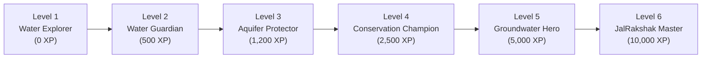

# JalRakshak XP Progression & Level Hierarchy Rules

## 1. Overview & Progression Mechanics

The JalRakshak progression engine motivates students through structured level progression, rewarding scientific inquiry, sustainable agricultural decisions, and successful crisis management.

All progression thresholds are centralized in `progression.config.js` to ensure consistent game balancing.

---

## 2. Level Hierarchy & Unlock Perks

Students progress across 6 distinct hydrological mastery tiers:



| Level | Title | Min XP Required | Delta to Next | Unlocked Curriculum & Capabilities |
| :---: | :--- | :---: | :---: | :--- |
| **1** | **Water Explorer** | $0\text{ XP}$ | $+500\text{ XP}$ | Access to basic village simulation and introductory missions |
| **2** | **Water Guardian** | $500\text{ XP}$ | $+700\text{ XP}$ | Unlock check dams and basic crop water budgeting |
| **3** | **Aquifer Protector** | $1,200\text{ XP}$ | $+1,300\text{ XP}$ | Unlock drip & sprinkler micro-irrigation and intermediate quests |
| **4** | **Conservation Champion** | $2,500\text{ XP}$ | $+2,500\text{ XP}$ | Unlock community percolation tanks and water quality bio-filters |
| **5** | **Groundwater Hero** | $5,000\text{ XP}$ | $+5,000\text{ XP}$ | Unlock advanced drought mitigation scenarios and classroom challenges |
| **6** | **JalRakshak Master** | $10,000\text{ XP}$ | *Max Tier* | Master hydrological governance, custom scenario modeling, and mentor badge |

---

## 3. Mathematical Progression Formula

For any user with total XP ($X$):

$$\text{Current Level } L = \max\Big\{ k \in \{1 \dots 6\} \;\Big|\; X \ge \text{MinXP}_k \Big\}$$

$$\text{XP to Next Level} = \begin{cases} \text{MinXP}_{L+1} - X, & \text{if } L < 6 \\ 0, & \text{if } L = 6 \end{cases}$$

$$\text{Level Progress } \% = \begin{cases} \frac{X - \text{MinXP}_L}{\text{MinXP}_{L+1} - \text{MinXP}_L} \times 100, & \text{if } L < 6 \\ 100\%, & \text{if } L = 6 \end{cases}$$

---

## 4. XP Award Streams & Sources

| Earning Source | Typical Award Range | Idempotency Key Format | Notes |
| :--- | :---: | :--- | :--- |
| **Mission Task Completion** | $50 - 250\text{ XP}$ | `TASK:<taskId>` | Awarded immediately upon passing task evaluation |
| **Mission Completion Bonus** | $100 - 500\text{ XP}$ | `MISSION:<missionId>` | Awarded when all sub-tasks reach 100% completion |
| **Achievement Unlocked** | $100 - 500\text{ XP}$ | `ACHIEVEMENT:<achievementId>` | Single-award lifetime milestone badges |
| **Daily Challenge** | $150\text{ XP}$ | `CHALLENGE:<challengeId>` | Awarded upon completing active daily challenge |
| **Weekly Challenge** | $250 - 300\text{ XP}$ | `CHALLENGE:<challengeId>` | Awarded upon completing active weekly challenge |

---

## 5. Security & Duplicate Prevention Architecture

Every XP award is audited through an immutable transactional ledger (`xp_transactions` table in PostgreSQL):

1. **Compound Unique Index**:
   ```prisma
   @@unique([userId, sourceType, sourceId])
   ```
2. **Idempotent Transactions**:
   Before crediting XP, the transaction checks if an entry for `(userId, sourceType, sourceId)` already exists.
   If found, the award is safely ignored (`alreadyAwarded: true`), preventing replay attacks or repeated reward claims.
3. **Transactional Atomic Rollbacks**:
   When a mission task is completed, updating task progress, updating mission status, and crediting the XP transaction occur in a single atomic database transaction (`prisma.$transaction`).
