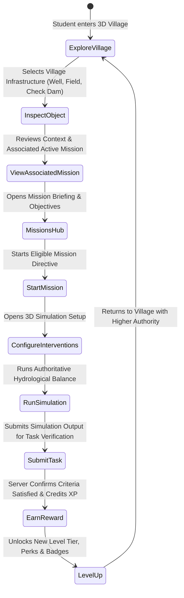

# JalRakshak — Student Gameplay & Educational Progression Flow

## 1. Student Journey Overview

JalRakshak immerses students into the role of a groundwater conservationist managing a virtual Indian village. Gameplay progresses through 4 interconnected phases:

---

## 2. Step-by-Step Gameplay Walkthrough

### Step 1: Village Exploration & Infrastructure Selection
- The student flies through the interactive 3D Indian village (terrains, farms, wells, check dams, and rooftop RWH houses).
- Selecting any structure opens the `RightContextPanel`, revealing:
  - Live groundwater metrics (drawdown, depth to water table, WQI).
  - Hydrological concept explanations.
  - Recommended conservation actions.
  - **Associated Active Mission Link** (e.g., Selecting agricultural fields links to `m-103: Precision Micro-Irrigation & Crop Diversification`).

### Step 2: Reviewing Mission Intel in Missions Hub
- Visiting `/missions` displays all available, in-progress, completed, and locked missions.
- Each mission specifies required student level, estimated duration, XP bounty, and category.
- Clicking a card opens `MissionDetail`:
  - Review pedagogical learning objectives (e.g. CGWB guidelines, specific yield of hard-rock basalt).
  - Inspect individual action tasks and their completion criteria.

### Step 3: Executing Authoritative Simulations for Tasks
- When a task requires simulation interventions (e.g., saving $\ge 15,000\,m^3$ with drip irrigation):
  1. Student clicks **"Launch 3D Simulation Setup"**.
  2. Modifies agricultural parameters (selects millets/pulses, DRIP irrigation, check dams).
  3. Clicks **"Run Authoritative Simulation"**.
  4. Backend computes discrete seasonal mass balance and returns results.
  5. Student returns to the mission detail modal and clicks **"Verify with Active Simulation"**.
  6. Backend `TaskEvaluator` strictly validates the actual simulation data.
  7. If verified, server marks the task completed and credits XP to the student's transaction ledger.

### Step 4: Progression & Leveling Up
- As XP accumulates, the `TopHUD` progress bar advances toward the next tier.
- Crossing tier thresholds triggers the celebratory `LevelUpModal`, awarding new level titles (e.g. *Water Explorer* $\to$ *Water Guardian* $\to$ *Aquifer Protector*) and unlocking advanced structures.

### Step 5: Quests & Honor Badges
- Students join daily and weekly quests on `/challenges`.
- Unlocking major milestones (e.g., saving $20,000\,m^3$ or building watershed structures) unlocks permanent honor badges on `/achievements`.
