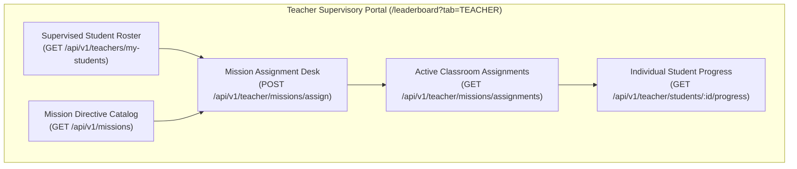

# JalRakshak — Teacher Supervisory & Classroom Gameplay Specification

## 1. Teacher Persona & Classroom Objective

In JalRakshak, educators play a vital supervisory and mentorship role. Teachers monitor student groundwater simulation performance, assign structured curriculum missions, and assess student conceptual comprehension of water conservation.

---

## 2. Teacher-Student Relationship & Authorization Security

Classroom supervision is strictly guarded by the `TeacherStudentAssignment` authorization relationship:
- A teacher can **only** supervise students officially assigned to their classroom.
- Attempting to inspect or assign missions to students outside their classroom returns HTTP `403 Forbidden`.
- Students cannot access teacher controls or view supervisory assignment panels.

---

## 3. Teacher Capabilities & Interface

### 3.1 Supervised Student Roster
- Fetches all authorized students via `GET /api/v1/teachers/my-students`.
- Displays student name, email, current level tier, and accumulated XP.

### 3.2 Assigning Missions
- Teachers select a student and assign any active mission from the catalog.
- Optional parameters:
  - **Due Date**: Target completion timestamp.
  - **Supervisory Notes**: Teacher directives (e.g., "Pay close attention to specific yield calculations and soil infiltration rates").
- Submits `POST /api/v1/teacher/missions/assign`.

### 3.3 Active Assignment Tracking & Progress Monitoring
- Displays all pending, in-progress, and completed assignments.
- Teachers can inspect an individual student's learning progress:
  - Total XP and Level tier.
  - Completed vs active missions with exact progress percentages.
  - Unlocked achievement badges and quiz scores.
