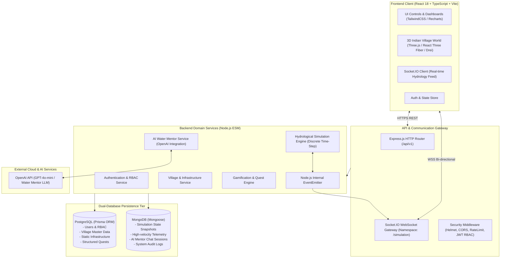

# JalRakshak System Architecture Specification

## 1. Architectural Philosophy: Modular Monolith

JalRakshak adopts a **Modular Monolith** architecture pattern. This approach avoids the premature complexity, network overhead, and distributed transaction challenges of microservices, while enforcing strict domain boundary separation, loose coupling, and high cohesion across modules.

---

## 2. Component Boundaries & Layers

### 2.1 Client Layer (Frontend SPA)
- **Interactive 3D Canvas**: Renders the village terrain, water table elevation, aquifer layers, recharge structures (check dams, percolation tanks), agricultural fields, and borewells using React Three Fiber.
- **Hydro-Analytics Dashboard**: Recharts-powered graphs visualizing depletion trends, water balance equations ($Recharge - Extraction = \Delta Storage$), and rainfall impact.
- **Real-time Synchronization**: Socket.IO client subscribes to simulation ticks, instantly updating 3D visual heights and analytical meters.
- **Role-Based Views**:
  - *Student*: Simulation controls, interactive scenario testing, gamified mission briefs, AI mentor dialogue.
  - *Teacher*: Village creation, scenario injection (e.g. drought, excessive tubewells), student performance monitoring.
  - *Admin*: Global system config, user role administration, telemetry auditing.

### 2.2 API & Real-time Gateway
- **Express HTTP Router**: Exposes versioned endpoints under `/api/v1/`.
- **Socket.IO Gateway**: Handles low-latency state broadcasting per village room (`room:village:<id>`).
- **Security Middlewares**:
  - `helmet`: HTTP headers protection.
  - `cors`: Strict origin validation against the client domain.
  - `express-rate-limit`: Prevents brute force and API saturation.
  - `verifyToken & checkRole`: Evaluates JWTs and verifies RBAC permissions before reaching controllers.

### 2.3 Backend Domain Services
- **Hydrological Simulation Engine**:
  - Operates on a discrete time-step loop (e.g., daily or monthly simulation ticks).
  - Computes Darcy-based groundwater flux, infiltration through unsaturated soil zones, evapotranspiration, and pumping drawdown cones.
  - Emits events via Node.js `EventEmitter` (`SIMULATION_TICK`, `DROUGHT_ALERT`, `CRITICAL_DEPLETION`).
- **Village & Infrastructure Service**: Manages village spatial profiles, soil types (alluvial, black soil, sandy loam), initial water table depths, and water structures.
- **Gamification Service**: Evaluates victory/failure criteria for student missions (e.g., "Restore Aquifer level to 12m depth within 18 simulated months").
- **AI Water Mentor Service**: Translates complex hydrological logs into tailored pedagogical guidance using OpenAI completions with structured prompts.

### 2.4 Persistence Layer: The Dual-Database Strategy
1. **PostgreSQL with Prisma**:
   - Strictly reserved for relational data requiring ACID guarantees: accounts, passwords, roles, villages, static infrastructure coordinates, and mission curricula.
2. **MongoDB with Mongoose**:
   - Optimized for append-heavy time-series telemetry (e.g., water level per tick), deep session histories, and flexible JSON payloads from LLM interactions.
   - **Collections**:
     - `activity_logs`: Student UI clicks, mission attempts, intervention actions.
     - `simulation_logs`: Discrete simulation step telemetry, recharge/extraction curves, drought events.
     - `conversations`: AI Water Mentor dialogue threads with embedded hydrogeological context.
     - `audit_logs`: Administrative actions and security changes.

---

## 3. Hydrological Simulation Model & Scientific Engine (Phase 7)

The core computational engine approximates village groundwater dynamics using an adapted water balance framework implemented across modular scientific services:

$$\Delta S = R_{natural} + R_{artificial} - (E_{agri} + E_{domestic} + E_{industrial} + D_{natural})$$
$$S_{final} = \max\Big(0, \; \min(S_{max}, \; S_{initial} + \Delta S)\Big)$$

### Modular Scientific Engine Architecture
- **`rainfallModel.js`**: Partitions precipitation volume into surface runoff, infiltration, and evaporative losses based on soil type and terrain slope, enforcing strict mass conservation ($C_{runoff} + C_{infil} + C_{evap} = 1.0$).
- **`rechargeModel.js`**: Calculates deep vadose percolation and artificial runoff capture across masonry check dams, percolation tanks, farm ponds, and rooftop rainwater harvesting (RWH) units.
- **`extractionModel.js`**: Determines agricultural draft by crop duty (Paddy, Sugarcane, Wheat, Millets, Pulses, Vegetables) and irrigation efficiency (Flood vs. Sprinkler 30% savings vs. Drip 48% savings), plus Jal Jeevan Mission domestic draft ($55\text{ LPCD}$).
- **`aquiferModel.js`**: Enforces capacity boundaries, prevents negative storage, computes unmet deficit upon exhaustion, rejects excess recharge upon saturation, and classifies water table state (`CRITICAL`, `SEMI_CRITICAL`, `SAFE`, `OPTIMAL`).
- **`waterQualityModel.js`**: Computes an educational Water Quality Index ($0 - 100$) simulating agrochemical leaching, untreated wastewater, recharge dilution, and deep drawdown geogenic mineral dissolution.
- **`sustainabilityModel.js`**: Multi-factor transparent rating ($0 - 100$) evaluating aquifer health (30%), recharge balance (25%), irrigation efficiency (20%), conservation interventions (15%), and water quality (10%).
- **`scenarioEngine.js`**: Supplies 6 pre-configured educational scenarios (`NORMAL_MONSOON`, `DROUGHT_YEAR`, `EXCESSIVE_EXTRACTION`, `SUSTAINABLE_FARMING`, `RAINWATER_HARVESTING`, `POLLUTION_CRISIS`).
- **`waterBalance.js`**: Master orchestrator running the complete simulation step and generating deterministic calculation summaries.

For the comprehensive mathematical specification, see [GROUNDWATER_MODEL.md](file:///docs/GROUNDWATER_MODEL.md).

---

## 4. Security & Governance Architecture

1. **Authentication**: Stateless Bearer JWT tokens signed with SHA-256 HMAC (15-minute access token) coupled with rotating refresh tokens (7 days). Plain-text refresh tokens are never persisted in the database; only deterministic SHA-256 hashes are stored in the PostgreSQL `refresh_tokens` table.
2. **Brute-Force & Rate Limiting**: `express-rate-limit` enforces a 20-attempt per 15-minute quota on `/api/v1/auth/login`.
3. **Public Registration Guard**: Public registration default is `STUDENT`. Requests attempting self-assignment to `ADMIN` are rejected at schema validation.
4. **RBAC Guard Matrix**:
   | Resource / Action | Student | Teacher | Administrator |
   | :--- | :---: | :---: | :---: |
   | Run Simulation & Intervene | Yes | Yes | Yes |
   | View Own Analytics & Missions | Yes | Yes | Yes |
   | Access Personal Profile & Update | Yes | Yes | Yes |
   | Create Custom Village Scenarios | No | Yes | Yes |
   | Assign Missions to Classrooms | No | Yes | Yes |
   | View Global System Audit Logs | No | No | Yes |
   | Manage Users & Roles | No | No | Yes |
5. **Data Integrity**: Inputs are validated at controller entry using Zod schemas (`auth.validation.js`) before hitting domain services.

---

## 5. Gamification & Progression Subsystem (Phase 8)

The gamification engine connects real scientific simulation results to educational quest mechanics:
1. **Mission Sub-Task Verification**: Server-side `TaskEvaluator` inspects authentic Phase 7 simulation balances (storage threshold, drip irrigation savings, artificial recharge, WQI) before approving task completion.
2. **Six-Tier Level Hierarchy**: Students progress from Level 1 *Water Explorer* to Level 6 *JalRakshak Master* via non-linear XP thresholds ($0 \rightarrow 500 \rightarrow 1,200 \rightarrow 2,500 \rightarrow 5,000 \rightarrow 10,000\text{ XP}$).
3. **Immutable XP Ledger**: Every XP award is recorded in `xp_transactions` with a compound unique constraint `(userId, sourceType, sourceId)` enforcing strict duplicate prevention.
4. **Teacher Classroom Assignments**: Teachers assign curated missions to authorized students, enforcing data-access boundaries.
5. **Privacy-Preserving Leaderboard**: Ranks students by Total XP, Weekly XP, Missions, and Badges while stripping emails and sensitive data.

For detailed progression rules, see [PROGRESSION_RULES.md](file:///docs/PROGRESSION_RULES.md) and [GAMIFICATION_SYSTEM.md](file:///docs/GAMIFICATION_SYSTEM.md).

---

## 6. Frontend Gamification & Progression Subsystem (Phase 11)

Phase 11 completes the full integration between the 3D game world and backend gamification:
1. **Server-Authoritative Progression**: The frontend never calculates XP or determines task success independently. All progression data is fetched from `/api/v1/progression/me`.
2. **Interactive Task Verification**: Students execute real Phase 7/10 simulations within the 3D village and submit returned simulation payloads for server-side evaluation (`POST /api/v1/missions/:id/tasks/:taskId/complete`).
3. **Missions Hub (`MissionsPage.tsx`)**: Complete filtering across 8 hydrological domains and 3 difficulty tiers, with search, sorting, and modal briefing cards.
4. **Time-Bound Quests (`ChallengesPage.tsx`)**: Active countdown timers for daily and weekly challenges with duplicate enrollment prevention.
5. **Progression HUD & Level-Up Celebrations**: Integrated into `TopHUD.tsx` with dynamic level badges, progress bars, non-intrusive XP toasts, and modal celebrations upon reaching new tiers.
6. **Honor Roll (`AchievementsPage.tsx`)**: Interactive collection tracking all 8 Phase 8 achievements with unlock conditions and reward celebrations.
7. **Privacy-Preserving Leaderboard (`LeaderboardPage.tsx`)**: Ranks students by Total XP, Weekly XP, Missions, and Badges without exposing personal emails or auth credentials.
8. **Teacher Supervisory Portal (`MissionAssignmentPanel.tsx`)**: Allows educators to browse missions, assign them to authorized students, set due dates, and monitor progress.
9. **3D Village Contextual Integration**: Interactive objects in the 3D village dynamically display associated active conservation missions and offer immediate simulation shortcuts.

For the full frontend specification, see [GAMIFICATION_FRONTEND.md](file:///docs/GAMIFICATION_FRONTEND.md), [STUDENT_GAMEPLAY_FLOW.md](file:///docs/STUDENT_GAMEPLAY_FLOW.md), and [TEACHER_GAMEPLAY.md](file:///docs/TEACHER_GAMEPLAY.md).

---

## 7. Teacher Dashboard & Classroom Management Subsystem (Phase 12)

Phase 12 establishes a dedicated EdTech educator cockpit for managing student cohorts, distributing curriculum missions, and auditing learning outcomes:
1. **Isolated EdTech Layout (`TeacherLayout.tsx`)**: Optimized for high-density information architecture with custom sidebar navigation, classroom alert feed, and seamless transitions to the 3D village without heavy WebGL canvas overhead.
2. **Supervisory Overview (`TeacherDashboardPage.tsx`)**: High-level KPIs (total supervised students, assignment completion %, average XP), urgent attention alerts for overdue/inactive students, and live classroom activity stream.
3. **Student Roster Management (`TeacherStudentsPage.tsx`)**: Searchable and filterable student roster showing level ranks, XP, completed missions, badges, and activity status.
4. **Pedagogical Diagnosis Portfolio (`TeacherStudentDetailPage.tsx`)**: Deep-dive individual profile showing learning strengths, targeted areas for improvement, complete mission history, badge collection, and printable progress record.
5. **Mission Assignments Cockpit (`TeacherAssignmentsPage.tsx`)**: Allows single-student or bulk classroom mission deployment with target completion dates and custom teacher guidance notes.
6. **Classroom Analytics Engine (`TeacherAnalyticsPage.tsx`)**: Recharts-powered interactive visualizations for XP distributions, 7-day simulation activity trends, curriculum domain coverage (%), and difficulty mastery rates.
7. **Compliance Audits & Streaming CSV Export (`TeacherReportsPage.tsx`)**: Generates print-ready formal institutional reports and streams standard RFC 4180 CSV exports of authorized student performance data.
8. **Strict Supervision Authorization**: Cross-teacher student data access is blocked at the service level (`TeacherAssignmentService.verifySupervision`), ensuring complete privacy isolation between different classrooms.

For the full educator documentation, see [TEACHER_DASHBOARD.md](file:///docs/TEACHER_DASHBOARD.md).

---

## 8. Admin Dashboard & Platform Governance Subsystem (Phase 13)

Phase 13 delivers an institutional-grade governance cockpit for system administrators:
1. **Administrative Shell (`AdminLayout.tsx`)**: Responsive multi-view console with system telemetry heartbeat indicators and fast transitions across user, curriculum, village, and analytics modules.
2. **Platform Overview Cockpit (`AdminDashboardPage.tsx`)**: 8 primary KPI cards aggregating real user cohorts, simulation workloads, and quest completions alongside registration velocity and mission status distributions.
3. **User Access Directory (`AdminUsersPage.tsx`)**: Comprehensive user directory with multi-tier search, role elevation/demotion, account activation/deactivation, and strict sole-admin protection guards.
4. **Teacher Oversight Console (`AdminTeachersPage.tsx`)**: Global directory tracking assigned student counts, dispatched classroom assignments, and identifying unassigned educators.
5. **Spatial Environment Modeling (`AdminVillagesPage.tsx`)**: Interactive watershed configurator for creating and modifying Indian village simulation models with geographical coordinates and population data.
6. **Curriculum Governance Hub (`AdminMissionsPage.tsx`)**: Authoring studio for educational missions, task definitions compatible with the Phase 8 `TaskEvaluator`, XP reward settings, and active status toggles.
7. **Community Challenge Cockpit (`AdminChallengesPage.tsx`)**: Launchpad for daily, weekly, and limited-time community events with strict start/end date verification.
8. **Platform Analytics Engine (`AdminAnalyticsPage.tsx`)**: Multi-dimensional analytics powered by Recharts comparing user roles, village simulation densities, progression level distributions, and monthly platform growth.
9. **Activity Audit Ledger (`AdminAuditLogsPage.tsx`)**: MongoDB-backed immutable audit log capturing administrative actions with graceful offline service-unavailable degradation.
10. **System Health Diagnostics (`AdminSystemHealthPage.tsx`)**: Live ping diagnostics probing connectivity for Core Express API, PostgreSQL, MongoDB, Socket.IO, and AI Water Mentor without exposing sensitive credentials or connection URIs.

For detailed specifications, see [ADMIN_DASHBOARD.md](file:///docs/ADMIN_DASHBOARD.md), [ADMIN_API.md](file:///docs/ADMIN_API.md), and [ADMIN_SECURITY.md](file:///docs/ADMIN_SECURITY.md).

---

## 9. Central Notifications, Communication & Real-Time Platform Integration (Phase 15)

Phase 15 establishes an event-driven notification infrastructure across all user roles:
1. **Central Notification Engine (`NotificationService`)**:
   - 12 standardized event categories (`MISSION_ASSIGNED`, `MISSION_COMPLETED`, `XP_EARNED`, `LEVEL_UNLOCKED`, `ACHIEVEMENT_UNLOCKED`, `CHALLENGE_STARTED`, `CHALLENGE_ENDING_SOON`, `TEACHER_ANNOUNCEMENT`, `ASSIGNMENT_DEADLINE_APPROACHING`, `ASSIGNMENT_OVERDUE`, `STUDENT_PROGRESS_UPDATE`, `PLATFORM_ANNOUNCEMENT`).
   - Anti-gaming guardrail: Notifications strictly announce authoritative backend events and **NEVER** award XP or alter level progression.
2. **Event-Driven Integration (`notificationEventBus`)**:
   - Decoupled event emission from Mission, Progression, Achievement, and Teacher Assignment services.
   - Built-in deduplication (`dedupKey`) preventing redundant alerts.
3. **Real-Time Delivery & Room Isolation**:
   - Socket.IO connection authenticated via verified JWT tokens.
   - Deterministic room allocation (`user:${userId}`, `role:${role}`, `role:ALL`) protecting against cross-user snooping.
4. **Classroom & Administrative Broadcasting**:
   - Teacher announcements restricted strictly to supervised students verified in PostgreSQL.
   - Admin announcements broadcasted platform-wide or targeted by role.
5. **Frontend Notification Center & Global HUD**:
   - Unified `NotificationBell` with live unread badge integrated across Student HUD (`TopHUD.tsx`), `TeacherLayout.tsx`, and `AdminLayout.tsx`.
   - Full dedicated notification center (`/notifications`) with tab filtering, mark-read, delete, and category delivery preferences.

For detailed specifications, see [NOTIFICATION_SYSTEM.md](file:///docs/NOTIFICATION_SYSTEM.md), [REALTIME_ARCHITECTURE.md](file:///docs/REALTIME_ARCHITECTURE.md), and [ANNOUNCEMENTS.md](file:///docs/ANNOUNCEMENTS.md).
