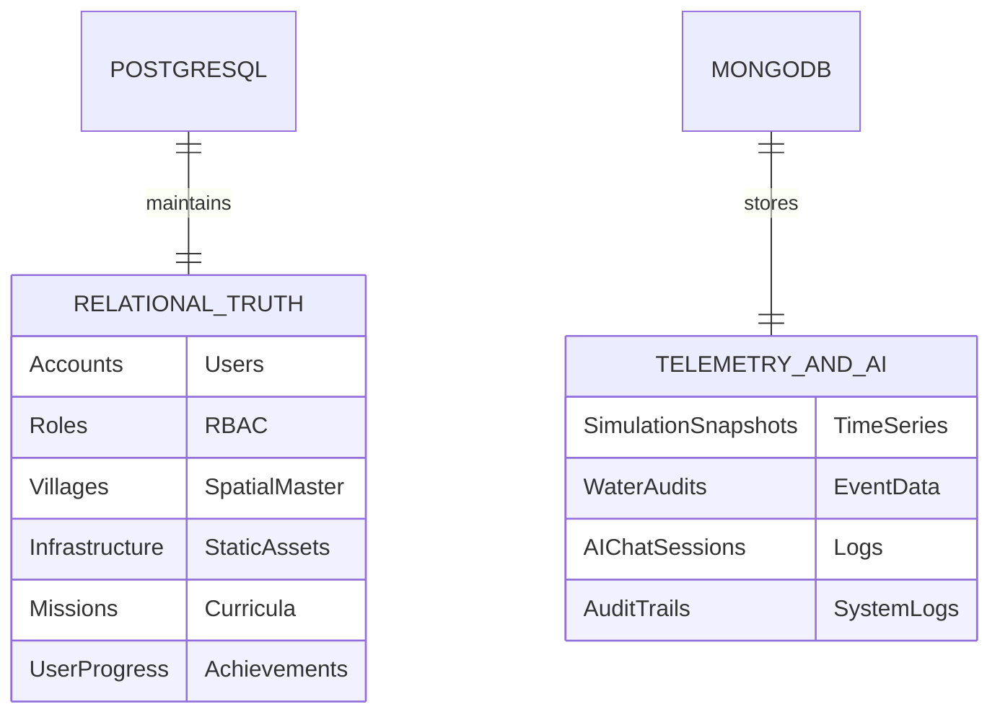

# JalRakshak Database Architecture Specification

## 1. Dual-Database Persistence Strategy

JalRakshak utilizes a polyglot persistence model designed to capitalize on the distinct strengths of relational and document databases:



### Why PostgreSQL (via Prisma ORM)?
- **ACID Compliance**: Crucial for user identity, role-based authorization, educational progress records, and village ownership.
- **Relational Integrity**: Foreign key constraints maintain unbreakable links between villages, their physical infrastructure, and student mission tracking.
- **Prisma Type Safety**: Direct TypeScript type generation synchronizes database definitions with backend services.

### Why MongoDB (via Mongoose)?
- **High-Velocity Telemetry**: Simulation runs emit state updates across every tick (water level, recharge volume, crop deficit). Storing these in a flexible, indexed document format prevents relational table bloat.
- **Dynamic AI Conversations**: Dialogues with the AI Water Mentor vary in token length, metadata, and context vectors. Document storage natively accommodates dynamic chat transcripts without complex schema migrations.
- **Fast Append Writes**: Telemetry writes do not lock transactional relational tables.

---

## 2. PostgreSQL Relational Model (Prisma Blueprint)

The target Prisma schema (`prisma/schema.prisma`) defines the core relational domain:

```prisma
datasource db {
  provider = "postgresql"
  url      = env("DATABASE_URL")
}

generator client {
  provider = "prisma-client-js"
}

enum Role {
  STUDENT
  TEACHER
  ADMIN
}

enum SoilType {
  ALLUVIAL
  BLACK_COTTON
  RED_SANDY_LOAM
  LATERITE
}

enum InfrastructureType {
  CHECK_DAM
  PERCOLATION_TANK
  BOREWELL
  DUGWELL
  ROOFTOP_HARVESTER
  FARM_POND
}

enum MissionStatus {
  NOT_STARTED
  IN_PROGRESS
  COMPLETED
  FAILED
}

model User {
  id           String        @id @default(uuid())
  email        String        @unique
  passwordHash String
  firstName    String
  lastName     String
  role         Role          @default(STUDENT)
  createdAt    DateTime      @default(now())
  updatedAt    DateTime      @updatedAt

  villages     Village[]     @relation("UserVillages")
  progress     UserMissionProgress[]

  @@index([email])
}

model Village {
  id                    String                   @id @default(uuid())
  name                  String
  state                 String                   @default("Maharashtra")
  district              String                   @default("Ahmednagar")
  areaHectares          Float
  population            Int
  soilType              SoilType                 @default(BLACK_COTTON)
  initialWaterTableDepth Float                   // in meters below ground level (bgl)
  currentWaterTableDepth Float                   // in meters bgl
  annualRainfallMm      Float
  creatorId             String
  creator               User                     @relation("UserVillages", fields: [creatorId], references: [id], onDelete: Cascade)
  createdAt             DateTime                 @default(now())
  updatedAt             DateTime                 @updatedAt

  infrastructures       WaterInfrastructure[]
  missions              Mission[]

  @@index([creatorId])
}

model WaterInfrastructure {
  id              String             @id @default(uuid())
  villageId       String
  village         Village            @relation(fields: [villageId], references: [id], onDelete: Cascade)
  type            InfrastructureType
  name            String
  xCoord          Float              // 3D coordinate X
  zCoord          Float              // 3D coordinate Z
  capacityM3      Float              // Storage/recharge or extraction capacity
  operationalRate Float              // Flow rate in m3/day
  isActive        Boolean            @default(true)
  installedAtTick Int                @default(0)
  createdAt       DateTime           @default(now())

  @@index([villageId, type])
}

model Mission {
  id                 String                @id @default(uuid())
  villageId          String?
  village            Village?              @relation(fields: [villageId], references: [id])
  title              String
  description        String
  difficulty         String                @default("Intermediate") // Beginner, Intermediate, Advanced
  targetWaterLevel   Float                 // Target depth in meters
  maxSimulatedMonths Int                   // Max allowable duration
  rewardPoints       Int                   @default(100)
  createdAt          DateTime              @default(now())

  progressRecords    UserMissionProgress[]
}

model UserMissionProgress {
  id           String        @id @default(uuid())
  userId       String
  missionId    String
  user         User          @relation(fields: [userId], references: [id], onDelete: Cascade)
  mission      Mission       @relation(fields: [missionId], references: [id], onDelete: Cascade)
  status       MissionStatus @default(IN_PROGRESS)
  score        Int           @default(0)
  completedAt  DateTime?
  createdAt    DateTime      @default(now())
  updatedAt    DateTime      @updatedAt

  @@unique([userId, missionId])
  @@index([userId, status])
}
```

---

## 3. MongoDB Document Schemas (Mongoose Blueprint)

### 3.1 Simulation Telemetry Log (`SimulationTelemetry`)
Stores time-series snapshots of village hydrogeology emitted per simulation tick.

```typescript
interface ISimulationTelemetry {
  villageId: string;
  simulationRunId: string;
  tickNumber: number;
  simulatedDate: Date;
  metrics: {
    waterTableDepthM: number;       // Depth below ground (meters)
    storageVolumeM3: number;        // Total volume in aquifer
    rainfallMm: number;             // Precipitation in current tick
    naturalRechargeM3: number;      // Natural infiltration
    artificialRechargeM3: number;   // Infiltration from check dams/pits
    extractionM3: number;           // Total pumping
    evapotranspirationM3: number;   // Evaporative loss
    netBalanceM3: number;           // Recharge - Extraction
  };
  activeInterventionsCount: number;
  createdAt: Date;
}
```
**Indexes**:
- `{ villageId: 1, simulationRunId: 1, tickNumber: 1 }` (Compound unique index)
- `{ createdAt: 1 }` (TTL index option for automatic historical archiving after 90 days)

---

### 3.2 AI Water Mentor Session Log (`AIMentorSession`)
Stores conversational threads between students and the AI mentor.

```typescript
interface IAIMentorMessage {
  sender: 'user' | 'mentor' | 'system';
  content: string;
  hydroContextSnapshot?: {
    waterTableDepthM: number;
    activeStressLevel: 'NORMAL' | 'MODERATE' | 'CRITICAL';
    topDeficitCrop?: string;
  };
  tokensUsed?: number;
  timestamp: Date;
}

interface IAIMentorSession {
  userId: string;
  villageId: string;
  missionId?: string;
  topic: string;
  messages: IAIMentorMessage[];
  createdAt: Date;
  updatedAt: Date;
}
```
**Indexes**:
- `{ userId: 1, villageId: 1 }`
- `{ updatedAt: -1 }`

---

### 3.3 System Audit Log (`AuditLog`)
Tracks administrative actions, role modifications, and system configuration adjustments.

```typescript
interface IAuditLog {
  actorId: string;
  actorRole: string;
  action: string;             // e.g. "USER_ROLE_UPDATED", "SCENARIO_INJECTED"
  resourceType: string;       // e.g. "Village", "User"
  resourceId: string;
  ipAddress: string;
  userAgent: string;
  metadata: Record<string, any>;
  timestamp: Date;
}
```
**Indexes**:
- `{ actorId: 1, timestamp: -1 }`
- `{ resourceType: 1, resourceId: 1 }`

---

## 4. Data Lifecycle, Indexing & Integrity Rules

1. **Foreign Keys**: Enforced via PostgreSQL with explicit cascading rules (`onDelete: Cascade` for child assets when a village or user is removed).
2. **Time-Series Telemetry Aging**: MongoDB telemetry logs will utilize capped collections or TTL expiry for non-essential historical runs, preserving storage.
3. **Data Segregation**: Student simulation test runs write telemetry tagged with `simulationRunId`, ensuring one user's trial does not contaminate persistent village baseline parameters.
